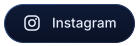
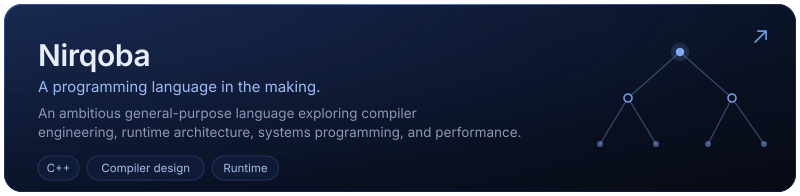
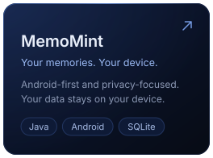
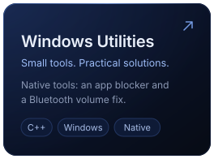
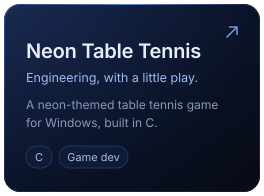
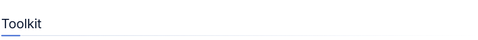
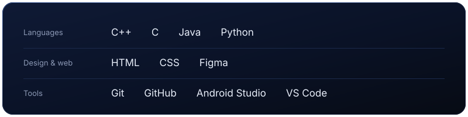
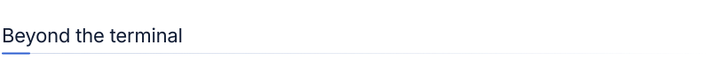
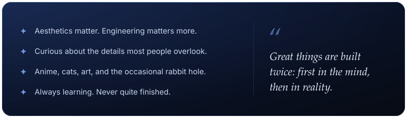

<picture>
  <source media="(prefers-color-scheme: dark)" srcset="assets/section-about-dark.svg">
  
</picture>

I'm **Muhammad Tahmid Ahnaf**, a Computer Science and Engineering student at **Khulna University of Engineering & Technology (KUET)**.

I enjoy working where engineering meets creativity: designing interfaces, exploring system architecture, understanding how things work under the hood, and building software that solves real problems.

I care about more than making things work. I care about **how they're built, why they're built that way, and how much better they could become.**

<picture>
  <source media="(prefers-color-scheme: dark)" srcset="assets/section-work-dark.svg">
  
</picture>

<a href="https://github.com/builtbyahnaf?tab=repositories">All repositories ↗</a>

<picture>
  <source media="(prefers-color-scheme: dark)" srcset="assets/section-toolkit-dark.svg">
  
</picture>

<picture>
  <source media="(prefers-color-scheme: dark)" srcset="assets/section-beyond-dark.svg">
  
</picture>

 

Designed with intention. Built with curiosity. © Muhammad Tahmid Ahnaf

