<picture>
  <source media="(prefers-color-scheme: dark)" srcset="assets/header-dark.svg">
  
</picture>

<a href="https://github.com/builtbyahnaf">
<picture>
  <source media="(prefers-color-scheme: dark)" srcset="assets/link-github-dark.svg">
  
</picture>
</a>
<a href="https://www.linkedin.com/in/unorthodoxahnaf/">
<picture>
  <source media="(prefers-color-scheme: dark)" srcset="assets/link-linkedin-dark.svg">
  
</picture>
</a>
<a href="https://www.instagram.com/_._ahnaf_._/">
<picture>
  <source media="(prefers-color-scheme: dark)" srcset="assets/link-instagram-dark.svg">
  
</picture>
</a>

<picture>
  <source media="(prefers-color-scheme: dark)" srcset="assets/section-about-dark.svg">
  
</picture>

I'm **Muhammad Tahmid Ahnaf**, a Computer Science and Engineering student at **Khulna University of Engineering & Technology (KUET)**.

I enjoy working where engineering meets creativity: designing interfaces, exploring system architecture, understanding how things work under the hood, and building software that solves real problems.

I care about more than making things work. I care about **how they're built, why they're built that way, and how much better they could become.**

<picture>
  <source media="(prefers-color-scheme: dark)" srcset="assets/section-work-dark.svg">
  
</picture>

<a href="https://github.com/builtbyahnaf/Project-Nirqoba">
<picture>
  <source media="(prefers-color-scheme: dark)" srcset="assets/card-nirqoba-dark.svg">
  
</picture>
</a>
<a href="https://github.com/builtbyahnaf/MemoMint_Android">
<picture>
  <source media="(prefers-color-scheme: dark)" srcset="assets/card-memomint-dark.svg">
  
</picture>
</a>
<a href="https://github.com/builtbyahnaf/Simple-App-Blocker-for-Windows">
<picture>
  <source media="(prefers-color-scheme: dark)" srcset="assets/card-windows-dark.svg">
  
</picture>
</a>
<a href="https://github.com/builtbyahnaf/Neon-Table-Tennis-Windows">
<picture>
  <source media="(prefers-color-scheme: dark)" srcset="assets/card-neon-dark.svg">
  
</picture>
</a>

<a href="https://github.com/builtbyahnaf?tab=repositories">All repositories ↗</a>

<picture>
  <source media="(prefers-color-scheme: dark)" srcset="assets/section-toolkit-dark.svg">
  
</picture>

<picture>
  <source media="(prefers-color-scheme: dark)" srcset="assets/toolkit-dark.svg">
  
</picture>

<picture>
  <source media="(prefers-color-scheme: dark)" srcset="assets/section-beyond-dark.svg">
  
</picture>

<picture>
  <source media="(prefers-color-scheme: dark)" srcset="assets/beyond-dark.svg">
  
</picture>

 

Designed with intention. Built with curiosity. © Muhammad Tahmid Ahnaf

