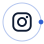

<picture>
  <source media="(prefers-color-scheme: dark)" srcset="assets/hero-dark.svg">
  
</picture>

<h1 align="center">Muhammad Tahmid Ahnaf</h1>

Assalamu Alaikum — may peace be upon you.

<i>Building systems. Exploring possibilities. Code with purpose. Design with intention.</i>

CSE student at KUET. Software developer and UI enthusiast.

<h3 align="center">
<a href="https://github.com/builtbyahnaf"><picture>
  <source media="(prefers-color-scheme: dark)" srcset="assets/icon-github-dark.svg">
  
</picture> GitHub</a>
&nbsp;&nbsp;&nbsp;&nbsp;
<a href="https://www.linkedin.com/in/unorthodoxahnaf/"><picture>
  <source media="(prefers-color-scheme: dark)" srcset="assets/icon-linkedin-dark.svg">
  
</picture> LinkedIn</a>
&nbsp;&nbsp;&nbsp;&nbsp;
<a href="https://www.instagram.com/_._ahnaf_._/"><picture>
  <source media="(prefers-color-scheme: dark)" srcset="assets/icon-instagram-dark.svg">
  
</picture> Instagram</a>
</h3>

<picture>
  <source media="(prefers-color-scheme: dark)" srcset="assets/divider-dark.svg">
  
</picture>

<h3 align="center">About</h3>

I'm <b>Muhammad Tahmid Ahnaf</b>, a Computer Science and Engineering student at <b>Khulna University of Engineering &amp; Technology (KUET)</b>.

I enjoy working where engineering meets creativity: designing interfaces, exploring system architecture, understanding how things work under the hood, and building software that solves real problems.

I care about more than making things work. I care about <b>how they're built, why they're built that way, and how much better they could become.</b>

<picture>
  <source media="(prefers-color-scheme: dark)" srcset="assets/divider-dark.svg">
  
</picture>

<h3 align="center">Selected work</h3>

<a href="https://github.com/builtbyahnaf/Project-Nirqoba">
<picture>
  <source media="(prefers-color-scheme: dark)" srcset="assets/nirqoba-dark.svg">
  
</picture>
</a>

<h3 align="center">Nirqoba</h3>

<i>A programming language in the making.</i>

An ambitious general-purpose language project exploring compiler engineering, runtime architecture, systems programming, and performance.

<code>C++</code> <code>Compiler design</code> <code>Runtime</code>

<a href="https://github.com/builtbyahnaf/Project-Nirqoba">View project ↗</a>

 

<a href="https://github.com/builtbyahnaf/MemoMint_Android"><picture>
  <source media="(prefers-color-scheme: dark)" srcset="assets/glyph-memomint-dark.svg">
  
</picture></a> 
<b>MemoMint</b> 
<i>Your memories. Your device. Your control.</i> 
An Android-first, privacy-focused personal memory app that keeps your data on-device. 
<code>Java</code> <code>Android</code> <code>SQLite</code>

<a href="https://github.com/builtbyahnaf/Simple-App-Blocker-for-Windows"><picture>
  <source media="(prefers-color-scheme: dark)" srcset="assets/glyph-windows-dark.svg">
  
</picture></a> 
<b>Windows Utilities</b> 
<i>Small tools. Practical solutions.</i> 
Native Windows utilities, including an app blocker and a Bluetooth volume fix. 
<code>C++</code> <code>Windows</code> <code>Native</code>

<a href="https://github.com/builtbyahnaf/Neon-Table-Tennis-Windows"><picture>
  <source media="(prefers-color-scheme: dark)" srcset="assets/glyph-neon-dark.svg">
  
</picture></a> 
<b>Neon Table Tennis</b> 
<i>A little engineering, a little play.</i> 
A neon-themed table tennis game for Windows, a creative coding project with a visual twist. 
<code>C</code> <code>Game development</code>

<a href="https://github.com/builtbyahnaf?tab=repositories">All repositories ↗</a>

<picture>
  <source media="(prefers-color-scheme: dark)" srcset="assets/divider-dark.svg">
  
</picture>

<h3 align="center">Toolkit</h3>

<i>Tools I use, technologies I explore, and skills I'm developing.</i>

<b>Languages</b>

<picture>
  <source media="(prefers-color-scheme: dark)" srcset="https://skillicons.dev/icons?i=cpp,c,java,python&theme=dark">
  
</picture>

<b>Design &amp; web</b>

<picture>
  <source media="(prefers-color-scheme: dark)" srcset="https://skillicons.dev/icons?i=html,css,figma&theme=dark">
  
</picture>

<b>Tools</b>

<picture>
  <source media="(prefers-color-scheme: dark)" srcset="https://skillicons.dev/icons?i=git,github,androidstudio,vscode&theme=dark">
  
</picture>

<picture>
  <source media="(prefers-color-scheme: dark)" srcset="assets/divider-dark.svg">
  
</picture>

<h3 align="center">Beyond the terminal</h3>

✦ Aesthetics matter. Engineering matters more. 
✦ Curious about the details most people overlook. 
✦ Anime, cats, art, and the occasional rabbit hole. 
✦ Always learning. Never quite finished.

<picture>
  <source media="(prefers-color-scheme: dark)" srcset="assets/constellation-dark.svg">
  
</picture>

<i>“Great things are built twice: first in the mind, then in reality.”</i>

<picture>
  <source media="(prefers-color-scheme: dark)" srcset="assets/divider-dark.svg">
  
</picture>

<h3 align="center">Consistency</h3>

<!-- Your original streak card (dark box): https://github-readme-streak-stats.herokuapp.com/?user=builtbyahnaf&hide_border=true&background=09090B&ring=818CF8&fire=FAFAFA&currStreakLabel=FAFAFA&sideLabels=A1A1AA&currStreakNum=FAFAFA&sideNums=E4E4E7&dates=71717A -->

<picture>
  <source media="(prefers-color-scheme: dark)" srcset="https://github-readme-streak-stats.herokuapp.com/?user=builtbyahnaf&hide_border=true&background=0D1117&ring=7FA8F5&fire=A18CFA&currStreakLabel=E8EEF9&sideLabels=8C99B5&currStreakNum=E8EEF9&sideNums=E8EEF9&dates=56648A">
  
</picture>

 

Designed with intention. Built with curiosity. © Muhammad Tahmid Ahnaf

